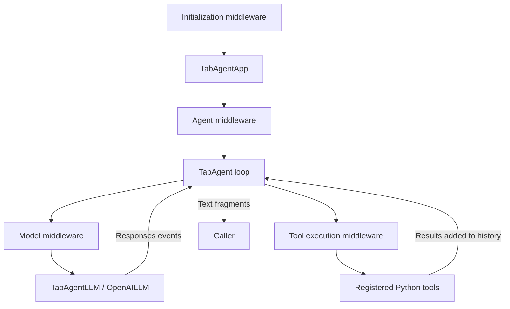

<p align="center">
  
</p>

# TabAgent

**An asynchronous Python agent harness built around middleware.**

**English** · [简体中文](README.zh-CN.md)

TabAgent combines streamed model responses, Python tools, conversation history, and resource management. Middleware surrounds application initialization, Agent runs, model calls, and tool execution so that you can prepare inputs, adjust behavior, inspect results, and clean up resources at each boundary.

The project is under active development. The current entry point is the Python API; the `tabagent` command still prints a placeholder greeting.

[Quick start](#quick-start) · [Architecture](#architecture) · [Middleware](#middleware) · [Tools](#tools) · [MCP](#mcp-client) · [Development](#development) · [Current scope](#current-scope)

## What you can build with it

- **Agents that use local tools.** Read and edit text files, search a project, evaluate expressions, and run commands.
- **Custom execution flows.** Wrap initialization, an entire Agent run, an individual model request, or an individual tool call.
- **Managed background commands.** Return a job ID while a command is running, then inspect its output or stop it through process tools.
- **MCP client integrations.** Connect to multiple servers, discover their capabilities, and invoke their tools through a standalone client module.

The model chooses among the tools exposed to it. The surrounding harness controls how requests are prepared, how tools execute, and how their results become the next model input.

## Quick start

### 1. Install

Use Python **3.12+** and [uv](https://docs.astral.sh/uv/). From a local checkout:

```bash
uv sync --locked
```

This installs the project and its locked dependencies into `.venv`. The checkout's `.python-version` selects Python 3.12.

The built-in Shell tool also requires the corresponding interpreter on `PATH`:

| Operating system | Selected tool | Interpreter |
| --- | --- | --- |
| Windows | `powershell` | `pwsh` preferred; `powershell` as fallback |
| Linux | `bash` | Bash |
| macOS | `zsh` | Zsh |

Only the current platform's Shell tool is registered.

### 2. Configure a model

Create a local `.env` with your endpoint, key, and model ID:

```dotenv
OPENAI_BASE_URL=https://api.openai.com/v1
OPENAI_API_KEY=your-api-key
OPENAI_MODEL=your-model-id
```

The current adapter uses the **OpenAI Responses API**, including streaming and function calling. `provider="openai"` is the only implemented provider. A custom `base_url` must support that protocol; a Chat Completions-only endpoint is not sufficient.

The example below explicitly calls `load_dotenv()`. The library constructors receive configuration as arguments and do not load `.env` themselves.

### 3. Run an Agent

Save this as `example.py` in the repository root:

```python
import asyncio
import os
from contextlib import aclosing
from pathlib import Path

from dotenv import load_dotenv

from tabagent.core.app import TabAgentApp
from tabagent.core.message import Message, UserMessage
from tabagent.middleware.logging_middleware import LoggingMiddleware
from tabagent.middleware.tool_middleware import ToolMiddleware


async def main() -> None:
    load_dotenv()

    messages: list[Message] = [
        UserMessage("Read README.md and summarize this project in three sentences."),
    ]

    async with TabAgentApp(
        base_url=os.environ["OPENAI_BASE_URL"],
        api_key=os.environ["OPENAI_API_KEY"],
        workspace=Path.cwd(),
        model=os.environ["OPENAI_MODEL"],
        instructions=(
            "Use the available tools when needed. "
            "Follow the user's requested scope and report actual tool results."
        ),
        middlewares=(
            LoggingMiddleware(),
            ToolMiddleware(),
        ),
    ) as app:
        async with aclosing(app.astream(messages=messages)) as stream:
            async for delta in stream:
                print(delta, end="", flush=True)
        print()


if __name__ == "__main__":
    asyncio.run(main())
```

```bash
uv run --locked python example.py
```

`ToolMiddleware` registers the built-in tools. `TabAgentApp` owns the LLM client and the shared process manager, and closes them when the context exits. `LoggingMiddleware` enables execution logs.

`astream()` returns an asynchronous generator of text fragments. Consume it with `async for`; use `aclosing()` to release the stream if iteration stops early.

### Continue a conversation

The Agent appends model output and tool results to the original `messages` list. Within the **same App context**, append another user message and stream again:

```python
messages.append(UserMessage("Which parts are still under development?"))

async with aclosing(app.astream(messages=messages)) as stream:
    async for delta in stream:
        print(delta, end="", flush=True)
print()
```

Application defaults:

| Option | Default | Meaning |
| --- | --- | --- |
| `max_model_calls` | `10` | Maximum model requests per Agent run |
| `timeout` | `60.0` | Passed to the model SDK as its request timeout |
| `max_retries` | `3` | Model SDK retry setting |
| `middlewares` | `()` | Middleware is enabled explicitly |
| `workspace` | Required | Fixed default directory for local operations |

If the final permitted model call still requests tools, the Agent raises `ModelCallLimitError` without executing those pending calls.

## Architecture



| Component | Responsibility |
| --- | --- |
| [`TabAgentApp`](src/tabagent/core/app.py) | Configuration, initialization, middleware composition, and owned-resource cleanup |
| [`TabAgent`](src/tabagent/core/agent.py) | Model/tool loop, conversation history, streamed text, and model-call limits |
| [`TabAgentLLM`](src/tabagent/core/llm.py) | Stable LLM entry point backed by the provider adapter factory |
| [`OpenAILLM`](src/tabagent/llm/openai_llm.py) | OpenAI client lifecycle and raw Responses stream events |
| [`MiddlewareManager`](src/tabagent/core/middleware.py) | Composition of the four middleware chains |
| [`ToolRegistry`](src/tabagent/tool/registry.py) | Python callables and the function definitions exposed to the model |
| [`ProcessManager`](src/tabagent/tool/tools/process/process_manager.py) | Local jobs, output buffers, runtime limits, and process cleanup |
| [`MCPClientManager`](src/tabagent/mcp/manager.py) | Independent MCP connections, capability catalogs, and remote tool calls |

`TabAgentLLM.astream()` yields raw model events. `TabAgent.astream()` and `TabAgentApp.astream()` yield displayable text. The Agent saves complete successful model output before executing requested tools and adding their results to the next request.

Model failures, incomplete responses, and missing completion events raise dedicated exceptions. Tool errors handled by the executor are returned as JSON error results.

## Middleware

Inherit from [`BaseMiddleware`](src/tabagent/middleware/base_middleware.py) and override the boundaries you need:

| Method | Request type | What it can control |
| --- | --- | --- |
| `wrap_init` | `AppInitRequest` | Configuration before LLM and Agent creation |
| `wrap_agent` | `AgentRequest` | Messages, LLM reference, model, instructions, tool registry, and call limit for one run |
| `wrap_model` | `ModelRequest` | Messages, model, instructions, and function definitions for one model request |
| `wrap_tool` | `ToolRequest` | Tool name, parsed arguments, and the returned result string |

For example, override instructions for a single run:

```python
from collections.abc import AsyncGenerator
from contextlib import aclosing

from tabagent.middleware.base_middleware import (
    AgentHandler,
    AgentRequest,
    BaseMiddleware,
)


class RunInstructionsMiddleware(BaseMiddleware):
    async def wrap_agent(
        self,
        call_next: AgentHandler,
        request: AgentRequest,
    ) -> AsyncGenerator[str, None]:
        request.instructions = (
            "Inspect relevant files before answering. "
            "For inspection requests, leave files unchanged."
        )
        async with aclosing(call_next(request)) as stream:
            async for delta in stream:
                yield delta
```

Pass instances through `TabAgentApp(middlewares=(...))`. Registration order `(A, B)` produces `A(B(execution))`: enter A, enter B, execute, exit B, exit A. Put cleanup that must also run on cancellation or failure in `finally`.

The Agent request receives a registry copy; model requests receive deep copies of messages and function definitions. Add executable tools through the Agent's registry. Adding a model-facing function definition alone does not register an executable function. Tool middleware must preserve `call_id`.

Available middleware:

- [`ToolMiddleware`](src/tabagent/middleware/tool_middleware.py) registers default local tools during initialization. Caller-provided tools with the same name take precedence.
- [`LoggingMiddleware`](src/tabagent/middleware/logging_middleware.py) records initialization, Agent runs, model calls, tool execution, and elapsed time.
- [`ModelMiddleware`](src/tabagent/middleware/model_middleware.py) validates model configuration and checks the requested model against the service's model list. It is optional and blocks initialization if that endpoint is unavailable or the model is absent. A successful list request does not prove generation will succeed.

## Tools

### Built-in tools

`ToolMiddleware` uses [`create_tools()`](src/tabagent/tool/tools/__init__.py) to assemble:

| Tool | Purpose |
| --- | --- |
| `calculate` | Evaluate supported arithmetic, constants, and math functions using a restricted AST evaluator |
| `list_directory` | List immediate entries, including hidden entries, with pagination |
| `find_paths` | Find files and directories by name or relative-path pattern |
| `search_text` | Search UTF-8 text using literal text or regular expressions |
| `read_file` | Read a text range and return continuation positions and a content version |
| `write_file` | Create a text file or explicitly replace its full contents; create missing parents |
| `edit_file` | Apply targeted text replacements, with an optional content-version check |
| `powershell` / `bash` / `zsh` | Run non-interactive commands using the current platform's Shell |
| `process_read` | Read a managed job's status and additional output |
| `process_list` | List jobs owned by the shared manager |
| `process_stop` | Request termination of a managed job |

Text-file tools support UTF-8 files up to **8 MiB**. Follow returned cursors or line/column continuation positions; results may be paginated or truncated. Use `expected_version` from a previous read when editing to detect stale content. These checks do not lock out external writers.

Search and path discovery can respect Git ignore rules when Git is installed and the target is in a repository. The current search implementation does not require `rg`. Dedicated file deletion, move, and copy tools are not part of the current built-in set.

### Background commands

With the shared process manager supplied by `TabAgentApp`, Shell execution can return before a command exits:

| Parameter/result | Meaning |
| --- | --- |
| `wait_time` | How long the tool waits before returning; default `2` seconds, range `0–30` |
| `timeout` | Total process runtime limit; default `120` seconds, `None`/JSON `null` disables this deadline |
| `job_id` | Manager-owned job identifier, not an operating-system PID |
| `next_cursor` | Position to pass back to `process_read` for additional output |

Reaching `wait_time` leaves the job running. Reaching `timeout` attempts to terminate it; it does not pause it. The Agent can proceed with other tool calls while the returned job continues.

Tool calls within an Agent response are still dispatched sequentially. Background jobs become independent after their launch call returns. Completion does not automatically resume or notify the model: query the process tools when results are needed.

Each Shell call starts a fresh process; `cd` and environment changes do not persist between calls. Keep long-running programs attached to the command, since detached descendants are not guaranteed to be tracked or stopped. Output retention is bounded; inspect truncation indicators. App exit closes its process manager and attempts to stop remaining jobs.

Using `create_tools()` without a shared `process_manager` makes Shell calls wait for completion and omits the process-management tools.

### Register your own tools

```python
from tabagent.tool.registry import ToolRegistry


def multiply(a: float, b: float) -> float:
    """Multiply two numbers."""
    return a * b


registry = ToolRegistry()
registry.register_tool(multiply)
```

Pass `tool_registry=registry` to `TabAgentApp`. Registration is synchronous, including for `async def` functions. During execution, the Agent awaits async tools and runs synchronous tools with `asyncio.to_thread()`.

Automatic Schema generation supports a basic annotation-to-type mapping. Provide an explicit `parameters=...` JSON Schema for arrays, nested objects, unions, or other complex inputs. With the default `strict=True`, automatically generated schemas require every parameter, including those with Python defaults. Positional-only parameters, `*args`, and `**kwargs` are not supported by the current registry.

Strings are returned to the model as-is. Other JSON-compatible values are serialized by the executor.

### Workspace behavior

`workspace` is resolved once as the default directory and must exist when using the built-in file and Shell tools. Relative file paths and Shell `cwd` use it; an explicit absolute path can target another location without changing the default.

**The workspace is a path base, not a sandbox or an authorization boundary.** Local operations use the host process's permissions. Applications that need enforced path restrictions or approval policies must implement them explicitly.

## MCP client

The [MCP module](src/tabagent/mcp/) uses **FastMCP** and can be used independently of the Agent. One `MCPServerClient` owns one configured server connection; `MCPClientManager` aggregates them.

- **Transports:** stdio, Streamable HTTP, and legacy SSE.
- **Configuration:** an explicitly supplied JSON path, environment-variable expansion, per-server timeouts, and required/optional servers.
- **Authentication:** custom headers, Bearer tokens, interactive OAuth, and client-credentials OAuth.
- **Discovery:** separate tool, resource, prompt, and resource-template catalogs, including errors and stale-data markers.
- **Execution:** explicit `(server_id, name)` routing and complete tool results. Resources and prompts are currently discovered, not read or rendered.
- **Lifecycle:** bounded startup concurrency, independent metadata discovery, explicit reconnect, and tracked cleanup.

Provide your server configuration in `resources/mcp_config.json`, for example:

```json
{
  "mcpServers": {
    "local-service": {
      "command": "uvx",
      "args": ["<your-mcp-server-package>"],
      "cwd": ".."
    }
  }
}
```

Replace the package placeholder with an actual MCP server. The command must be available on `PATH`. Relative `cwd` is resolved from the configuration file's directory.

```python
import asyncio

from tabagent.mcp import MCPClientManager


async def inspect_mcp() -> None:
    async with MCPClientManager(
        config_path="resources/mcp_config.json",
    ) as manager:
        await manager.wait_ready(include_metadata=True)

        for server_id, info in manager.get_server_infos().items():
            print(server_id, info.state, info.error)

        for entry in manager.get_tools():
            print(entry.server_id, entry.tool.name, entry.tool.input_schema)


if __name__ == "__main__":
    asyncio.run(inspect_mcp())
```

Invoke a discovered tool with `await manager.call_tool(server_id=..., name=..., arguments=...)`. The result preserves content blocks, structured content, and `is_error`. Tool calls are not automatically retried after a timeout or disconnection.

By default, opening waits for tool discovery; `wait_ready(include_metadata=True)` also waits for the other catalogs. `connect(wait_for_optional=False)` allows optional services to start in the background. Cleanup timeouts remain visible through `cleanup_error` and `cleanup_pending`.

**MCP is not yet wired into `TabAgentApp` or `ToolRegistry`.** The client module is implemented; the Agent adapter and MCP middleware are the next integration layer.

See the [MCP guide](src/tabagent/mcp/README.md) for complete configuration, authentication, lifecycle behavior, and tests. Actual OAuth login needs validation against your chosen service.

## Logging

Logging uses [Loguru](https://github.com/Delgan/loguru). Settings live in [`core/config.py`](src/tabagent/core/config.py) under `log_config.console` and `log_config.file`.

| Destination | Default configuration |
| --- | --- |
| Console | `INFO` and above, colored output |
| File | `DEBUG` and above, UTF-8, `logs/tabagent.log` in a source checkout |
| Rotation | `10 MB` per file |
| Retention | `7 days`, checked when rotation runs |

Both sinks use queued writes. Configuration is applied when [`core/logger.py`](src/tabagent/core/logger.py) is first imported. Other modules can import `logger` from there. Multiple rotated files can exceed 10 MB in total.

## Development

Run the independent MCP regression suite without model credentials:

```bash
uv run --locked python -B -m pytest src/tabagent/mcp/tests -q -p no:cacheprovider
```

It covers configuration, discovery limits, cancellation and cleanup, reconnect, real in-memory and stdio services, and local HTTP/SSE transports.

The top-level `test/` directory also contains manual examples:

| Command | Purpose |
| --- | --- |
| `uv run --locked pytest -s test/test_function.py` | Inspect local function registration and Schema generation |
| `uv run --locked pytest -s test/test_logger.py` | Exercise console/file logging |
| `uv run --locked pytest -s test/test_agent.py::test_agent` | Interactive arithmetic Agent; enter `exit` to quit |
| `uv run --locked pytest -s test/test_app.py::test_app_with_middleware` | Observe middleware execution order |
| `uv run --locked pytest -s test/test_llm.py::test_llm_model_list` | Query a configured provider's model list |

Model examples make real API requests. Some examples wait for terminal input or contain machine-specific workspace paths. Inspect and adjust them before running; `-s` allows interactive input. A bare `pytest` targets `test/` and does **not** include the MCP regression suite automatically.

For changes, keep the scope focused, add regression coverage for behavior that can fail, and keep the English and Chinese READMEs aligned.

## Project layout

```text
src/tabagent/
├── core/                 # App, Agent loop, messages, middleware composition, logging
├── llm/                  # LLM interface, adapter factory, OpenAI Responses backend
├── middleware/           # Base, logging, model-check, and default-tool middleware
├── tool/
│   ├── registry.py       # Callable registration and model-facing definitions
│   └── tools/
│       ├── calulate/     # Calculator; current package spelling
│       ├── file/         # Text-file and search tools
│       ├── shell/        # Platform-specific command launchers
│       ├── process/      # Shared job manager and process tools
│       └── web_search/   # Placeholder
├── mcp/                  # Standalone FastMCP client, guide, and regression tests
└── skill/                # Placeholder
resources/                # User-supplied MCP configuration
test/                     # Local checks and manual/live examples
README.md                 # English
README.zh-CN.md           # Simplified Chinese
```

## Current scope

The current implementation supports the Python Agent API, four middleware boundaries, local tools, managed jobs, and a standalone MCP client.

The following remain unfinished:

- Automatic exposure of MCP tools to the Agent and App-owned MCP lifecycle.
- Context, memory, and skill middleware; the skill module and web-search tool.
- Additional LLM provider implementations. The DeepSeek and Qwen files are placeholders.
- Integration of the separate `AgentLifecycle` hook definitions. Execution currently uses middleware.
- A complete CLI and broader automated coverage of the Agent, local tools, and platform behavior.

The provider abstraction currently shares Responses-style event types with the Agent. Supporting another model protocol requires event adaptation as well as a new client implementation.
