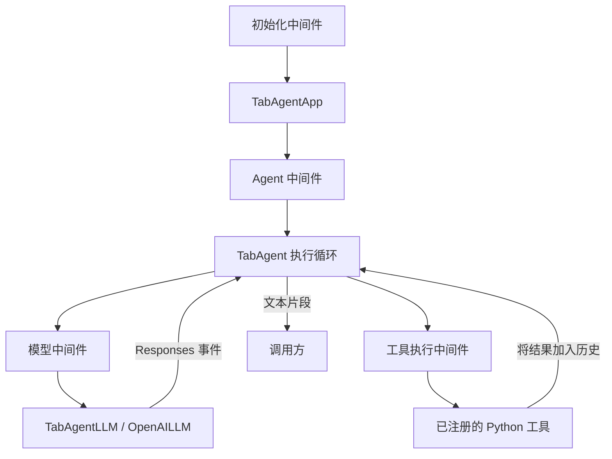

<p align="center">
  
</p>

# TabAgent

**以中间件为核心的异步 Python Agent 执行框架。**

[English](README.md) · **简体中文**

TabAgent 将模型流式响应、Python 工具、对话历史和资源管理组织为一个 Agent harness。中间件包围应用初始化、Agent 运行、模型调用和工具执行，让你在各个边界准备输入、调整行为、检查结果和清理资源。

项目处于早期开发阶段（Alpha），API 可能调整。目前通过 Python API 使用，暂未注册 `tabagent` 命令行入口。

[快速开始](#快速开始) · [架构](#架构) · [中间件](#中间件) · [工具](#工具) · [MCP](#mcp-客户端) · [开发与测试](#开发与测试) · [当前范围](#当前范围) · [反馈](#反馈) · [许可证](#许可证)

## 可以用它做什么

- **构建使用本地工具的 Agent。** 读取和修改文本文件、检索项目、计算表达式、运行命令。
- **定制执行流程。** 包装初始化、一次完整 Agent 运行、单次模型请求或单次工具调用。
- **管理后台命令。** 程序仍在运行时返回任务标识，之后通过进程工具读取输出或停止任务。
- **接入 MCP 服务。** 通过独立客户端模块连接多个服务、发现能力目录并调用工具。

模型负责从暴露给它的工具中选择调用对象，外层 harness 负责准备请求、执行工具，并将结果组织成下一次模型输入。

## 快速开始

### 1. 安装

需要 Python **3.12+**、Git 和 [uv](https://docs.astral.sh/uv/)。从源码仓库开始：

```bash
git clone https://github.com/TangRj-Git/TabAgent.git
cd TabAgent
uv sync --locked
```

如果已经克隆仓库，只需在项目根目录执行 `uv sync --locked`。该命令根据锁文件，将本地项目及其依赖安装到 `.venv`，不会发布安装包。项目的 `.python-version` 指定 Python 3.12。

默认同步还会安装 `dev` 开发依赖组：`pytest` 用于本地示例，`python-dotenv` 用于在下方示例中加载 `.env`。库本身的构造函数不依赖 `python-dotenv`。

内置 Shell 工具还要求系统对应的解释器能够通过 `PATH` 找到：

| 操作系统 | 选择的工具 | 解释器 |
| --- | --- | --- |
| Windows | `powershell` | 优先使用 `pwsh`，否则使用 `powershell` |
| Linux | `bash` | Bash |
| macOS | `zsh` | Zsh |

只注册当前操作系统对应的一个 Shell 工具。

### 2. 配置模型

将 [.env.example](.env.example) 复制为本地 `.env`（如果已经存在，则保留原有配置），然后填写服务地址、密钥和模型名称。本地 `.env` 文件已被 Git 忽略，请勿提交真实凭据。

```dotenv
OPENAI_BASE_URL=https://api.openai.com/v1
OPENAI_API_KEY=your-api-key
OPENAI_MODEL=your-model-id
```

当前适配器使用 **OpenAI Responses API**，需要服务支持流式响应和函数调用。`provider="openai"` 是目前唯一实现的供应商选项。自定义 `base_url` 也必须支持这一协议，仅支持 Chat Completions 的接口不能直接使用。

下面的示例显式调用 `load_dotenv()`。库的构造函数通过参数接收配置，不会自行读取 `.env`。

### 3. 运行 Agent

将下面的代码保存为项目根目录下的 `example.py`：

此示例会发出真实模型请求，可能产生服务费用。它还会以当前进程权限向 Agent 提供本地文件和 Shell 工具，请选择你允许 Agent 访问的工作目录。

```python
import asyncio
import os
from contextlib import aclosing
from pathlib import Path

from dotenv import load_dotenv

from tabagent.core.app import TabAgentApp
from tabagent.core.message import Message, UserMessage
from tabagent.middleware.logging_middleware import LoggingMiddleware
from tabagent.middleware.tool_middleware import ToolMiddleware


async def main() -> None:
    load_dotenv()

    messages: list[Message] = [
        UserMessage("读取 README.md，用三句话介绍这个项目。"),
    ]

    async with TabAgentApp(
        base_url=os.environ["OPENAI_BASE_URL"],
        api_key=os.environ["OPENAI_API_KEY"],
        workspace=Path.cwd(),
        model=os.environ["OPENAI_MODEL"],
        instructions=(
            "根据需要使用提供的工具。"
            "遵守用户要求的操作范围，根据实际工具结果回答。"
        ),
        middlewares=(
            LoggingMiddleware(),
            ToolMiddleware(),
        ),
    ) as app:
        async with aclosing(app.astream(messages=messages)) as stream:
            async for delta in stream:
                print(delta, end="", flush=True)
        print()


if __name__ == "__main__":
    asyncio.run(main())
```

```bash
uv run --locked python example.py
```

`ToolMiddleware` 注册内置工具。`TabAgentApp` 持有 LLM 客户端和共享进程管理器，并在退出上下文时关闭它们。`LoggingMiddleware` 提供执行日志。

`astream()` 返回逐段产生文本的异步生成器，使用 `async for` 读取；用 `aclosing()` 确保提前停止迭代时也能释放流资源。

### 继续对话

Agent 会把模型输出和工具结果追加到原来的 `messages` 列表。在**同一个 App 上下文中**，追加用户消息后再次读取流即可：

```python
messages.append(UserMessage("哪些部分还在开发中？"))

async with aclosing(app.astream(messages=messages)) as stream:
    async for delta in stream:
        print(delta, end="", flush=True)
print()
```

应用默认参数：

| 参数 | 默认值 | 含义 |
| --- | --- | --- |
| `max_model_calls` | `10` | 一次 Agent 运行最多请求模型的次数 |
| `timeout` | `60.0` | 传给模型 SDK 的请求超时配置 |
| `max_retries` | `3` | 模型 SDK 的重试配置 |
| `middlewares` | `()` | 中间件需要显式启用 |
| `workspace` | 必填 | 本地操作使用的固定默认目录 |

如果最后一次允许的模型请求仍要求调用工具，Agent 会抛出 `ModelCallLimitError`，不会执行这批待调用工具。

## 架构



| 组件 | 职责 |
| --- | --- |
| [`TabAgentApp`](src/tabagent/core/app.py) | 接收配置、初始化对象、组装中间件并清理持有的资源 |
| [`TabAgent`](src/tabagent/core/agent.py) | 模型与工具执行循环、对话历史、流式文本和模型调用次数限制 |
| [`TabAgentLLM`](src/tabagent/core/llm.py) | 稳定的 LLM 入口，通过供应商工厂选择底层实现 |
| [`OpenAILLM`](src/tabagent/llm/openai_llm.py) | 管理 OpenAI 客户端并提供原始 Responses 流式事件 |
| [`MiddlewareManager`](src/tabagent/core/middleware.py) | 组装四类中间件调用链 |
| [`ToolRegistry`](src/tabagent/tool/registry.py) | 保存 Python 可调用对象及提供给模型的函数定义 |
| [`ProcessManager`](src/tabagent/tool/tools/process/process_manager.py) | 管理本地任务、输出缓冲、运行时限和进程清理 |
| [`MCPClientManager`](src/tabagent/mcp/manager.py) | 独立管理 MCP 连接、能力目录和远程工具调用 |

`TabAgentLLM.astream()` 产生原始模型事件；`TabAgent.astream()` 和 `TabAgentApp.astream()` 产生用于展示的文本。Agent 保存完整且成功的模型输出，再执行其中的工具调用，将工具结果加入下一轮请求。

模型失败、不完整响应或缺少完成事件会抛出专门的异常。执行器捕获的工具错误会转换为 JSON 错误结果返回。

## 中间件

继承 [`BaseMiddleware`](src/tabagent/middleware/base_middleware.py)，按需重写对应的包装方法：

| 方法 | 请求类型 | 可控制的内容 |
| --- | --- | --- |
| `wrap_init` | `AppInitRequest` | 创建 LLM 和 Agent 之前的初始化配置 |
| `wrap_agent` | `AgentRequest` | 本次运行的消息、LLM 引用、模型、指令、工具注册表和调用次数上限 |
| `wrap_model` | `ModelRequest` | 单次模型请求的消息、模型、指令和函数定义 |
| `wrap_tool` | `ToolRequest` | 工具名称、解析后的参数，以及返回的结果字符串 |

例如，为单次运行覆盖指令：

```python
from collections.abc import AsyncGenerator
from contextlib import aclosing

from tabagent.middleware.base_middleware import (
    AgentHandler,
    AgentRequest,
    BaseMiddleware,
)


class RunInstructionsMiddleware(BaseMiddleware):
    async def wrap_agent(
        self,
        call_next: AgentHandler,
        request: AgentRequest,
    ) -> AsyncGenerator[str, None]:
        request.instructions = (
            "回答之前先检查相关文件。"
            "对于检查请求，不要修改文件。"
        )
        async with aclosing(call_next(request)) as stream:
            async for delta in stream:
                yield delta
```

通过 `TabAgentApp(middlewares=(...))` 传入实例。注册顺序 `(A, B)` 对应 `A(B(实际执行))`：进入 A、进入 B、执行、退出 B、退出 A。异常或取消时也必须执行的清理逻辑应放在 `finally` 中。

Agent 请求获得工具注册表副本；模型请求获得消息和函数定义的深拷贝。添加可执行工具应操作 Agent 的注册表，仅增加发送给模型的函数定义不会注册实际函数。工具中间件必须保持 `call_id` 不变。

目前可用的中间件：

- [`ToolMiddleware`](src/tabagent/middleware/tool_middleware.py)：初始化时注册默认本地工具；调用方已经注册的同名工具优先。
- [`LoggingMiddleware`](src/tabagent/middleware/logging_middleware.py)：记录初始化、Agent 运行、模型调用、工具执行及耗时。
- [`ModelMiddleware`](src/tabagent/middleware/model_middleware.py)：校验模型配置，并查询服务的模型列表确认目标模型存在。它是可选中间件；列表接口不可用或模型不存在时会阻止初始化。模型列表查询成功不能保证生成请求一定成功。

## 工具

### 内置工具

`ToolMiddleware` 通过 [`create_tools()`](src/tabagent/tool/tools/__init__.py) 汇总工具：

| 工具 | 用途 |
| --- | --- |
| `calculate` | 使用受限的 AST 求值器执行支持的算术、常量和数学函数 |
| `list_directory` | 分页列出目录的直接子项，包括隐藏项 |
| `find_paths` | 按名称或相对路径模式查找文件和目录 |
| `search_text` | 使用普通文本或正则表达式检索 UTF-8 文本 |
| `read_file` | 读取文本范围，返回续读位置和内容版本 |
| `write_file` | 创建文本文件，或显式覆盖完整内容；按需创建父目录 |
| `edit_file` | 精确替换文本片段，可选检查内容版本 |
| `powershell` / `bash` / `zsh` | 使用当前系统对应的 Shell 执行非交互命令 |
| `process_read` | 查询托管任务状态并读取后续输出 |
| `process_list` | 列出共享管理器持有的任务 |
| `process_stop` | 请求终止一个托管任务 |

文本文件工具支持最大 **8 MiB** 的 UTF-8 文件。结果可能分页或截断，应使用返回的游标或行列位置继续读取。编辑时传入之前读取到的 `expected_version`，可以发现内容已变化的情况；版本检查不会锁住其他程序的写入。

安装了 Git 且目标位于仓库中时，内容检索和路径查找可以应用 Git 忽略规则。当前检索实现不依赖 `rg`。现有内置工具中还没有独立的文件删除、移动和复制工具。

### 后台命令

使用 `TabAgentApp` 提供的共享进程管理器时，Shell 可以在命令结束之前返回：

| 参数或结果 | 含义 |
| --- | --- |
| `wait_time` | 本次工具等待多久再返回，默认 `2` 秒，范围 `0–30` |
| `timeout` | 进程总运行时限，默认 `120` 秒；`None` / JSON `null` 表示不设置这个时限 |
| `job_id` | 管理器中的任务标识，不是操作系统 PID |
| `next_cursor` | 传给 `process_read`、用于读取后续输出的位置 |

达到 `wait_time` 时任务继续运行；达到 `timeout` 时会尝试终止任务，不是暂停。启动工具返回后，Agent 可以继续其他工具调用，同时让这个任务在后台运行。

同一轮模型响应中的工具仍然按顺序调度。后台任务在启动调用返回后独立运行；完成时不会自动唤醒模型或发送通知，需要结果时应主动查询进程工具。

每次 Shell 调用都会创建新进程，`cd` 和环境变量修改不会延续到下一次调用。长时间运行的程序应保持附着在命令进程上，脱离的后代进程不保证能被追踪或终止。保留的输出有大小限制，应检查截断标记。App 退出时会关闭进程管理器并尝试停止剩余任务。

直接使用 `create_tools()` 而不传共享 `process_manager` 时，Shell 会等待执行完成，也不会创建进程管理工具。

### 注册自己的工具

```python
from tabagent.tool.registry import ToolRegistry


def multiply(a: float, b: float) -> float:
    """Multiply two numbers."""
    return a * b


registry = ToolRegistry()
registry.register_tool(multiply)
```

将 `tool_registry=registry` 传给 `TabAgentApp`。注册是同步操作，注册 `async def` 函数也不需要 `await`。执行时，Agent 会等待异步工具，并通过 `asyncio.to_thread()` 运行同步工具。

自动 Schema 构建目前提供基本的类型注解映射。数组、嵌套对象、联合类型等复杂输入应显式传入 `parameters=...` JSON Schema。默认 `strict=True` 时，自动生成的 Schema 会将所有参数列为必填，包括有 Python 默认值的参数。当前注册器不支持仅限位置的参数、`*args` 和 `**kwargs`。

字符串结果原样交给模型；其他兼容 JSON 的值由执行器序列化。

### 工作目录行为

`workspace` 会在创建时解析为固定默认目录，使用内置文件和 Shell 工具时该目录必须已经存在。相对文件路径和 Shell 的相对 `cwd` 都以它为基准；显式绝对路径可以操作其他位置，但不会改变默认目录。

**workspace 是路径基准，不是沙箱，也不是授权边界。** 本地操作使用宿主进程的权限。如果应用需要强制限制目录或执行审批策略，需要显式实现这些限制。

## MCP 客户端

[MCP 模块](src/tabagent/mcp/) 使用 **FastMCP**，可以独立于 Agent 使用。一个 `MCPServerClient` 持有一个配置服务的连接，`MCPClientManager` 负责汇总管理。

- **传输方式：** stdio、Streamable HTTP 和旧版 SSE。
- **配置：** 显式注入 JSON 路径，支持环境变量展开、单服务超时和必需/可选服务。
- **认证：** 自定义请求头、Bearer token、交互式 OAuth 和客户端凭据 OAuth。
- **发现：** 分别保存工具、资源、Prompt 和资源模板目录，包括错误与旧数据标记。
- **执行：** 通过 `(server_id, name)` 明确路由，保留完整工具结果；目前只发现资源和 Prompt，不读取资源内容或渲染 Prompt。
- **生命周期：** 限制启动并发数，独立发现元数据，支持显式重连和清理任务追踪。

连接前请先检查 [resources/mcp_config.json](resources/mcp_config.json)。仓库中的配置包含本地开发设置，例如 Windows 的 `cmd.exe` 命令和本机绝对路径。请按自己的环境调整路径和命令，并禁用或移除不打算启动的服务。

如果只需要一个时间服务，可以使用以下最小配置：

```json
{
  "mcpServers": {
    "time": {
      "transport": "stdio",
      "command": "uvx",
      "args": [
        "--from",
        "mcp-server-time==2026.10.19",
        "mcp-server-time"
      ],
      "cwd": "..",
      "env": {
        "PYTHONIOENCODING": "utf-8"
      },
      "required": true,
      "connect_timeout": 180.0
    }
  }
}
```

将配置保存到 `resources/mcp_config.json`，或给管理器传入自己的 JSON 路径。`uvx` 需要能够通过 `PATH` 找到；首次运行可能下载服务包，需要网络访问。只启动你信任的服务包。相对 `cwd` 以配置文件所在目录为基准，因此这里的 `".."` 指向仓库根目录。

MCP 配置支持在字符串值中使用 `${NAME}` 引用环境变量。取值来自当前进程环境，加载器不会自动读取 `.env`；如有需要，应在加载配置或连接之前显式调用 `load_dotenv()`。不要把真实凭据写入已提交的 JSON 文件。

可以先只校验配置，不启动任何服务，也不请求模型：

```bash
uv run --locked python -c "from tabagent.mcp import load_mcp_config; config = load_mcp_config('resources/mcp_config.json'); print('Configured servers:', ', '.join(config.servers))"
```

该检查验证配置格式和本地工作目录，不验证命令是否可用、连接是否成功或认证是否有效。确认配置后，下方 Python 示例才会真正启动配置的服务并发现其能力：

```python
import asyncio

from tabagent.mcp import MCPClientManager


async def inspect_mcp() -> None:
    async with MCPClientManager(
        config_path="resources/mcp_config.json",
    ) as manager:
        await manager.wait_ready(include_metadata=True)

        for server_id, info in manager.get_server_infos().items():
            print(server_id, info.state, info.error)

        for entry in manager.get_tools():
            print(entry.server_id, entry.tool.name, entry.tool.input_schema)


if __name__ == "__main__":
    asyncio.run(inspect_mcp())
```

通过 `await manager.call_tool(server_id=..., name=..., arguments=...)` 调用发现的工具。结果保留内容块、结构化内容和 `is_error`。超时或断线后不会自动重试工具调用。

默认打开客户端时等待工具目录；`wait_ready(include_metadata=True)` 还会等待其他目录。`connect(wait_for_optional=False)` 可以让可选服务在后台启动。清理超时通过 `cleanup_error` 和 `cleanup_pending` 保持可见。

`startup_concurrency` 限制同时执行启动流程的服务数量，不限制最终连接总数，也不是工具调用并发上限。将服务的 `required` 设为 `true` 后，连接或工具目录发现失败会导致管理器启动失败；可选服务的错误可以通过其状态和目录查询。

**MCP 尚未接入 `TabAgentApp` 或 `ToolRegistry`。** 客户端模块已经实现，Agent 适配器和 MCP 中间件属于下一层集成工作。

配置字段和校验规则见 [config.py](src/tabagent/mcp/config.py) 与 [config_loader.py](src/tabagent/mcp/config_loader.py)，生命周期协调逻辑见 [manager.py](src/tabagent/mcp/manager.py)。实际 OAuth 登录需要针对选用的服务验证。

## 日志

日志使用 [Loguru](https://github.com/Delgan/loguru)，由 [`core/config.py`](src/tabagent/core/config.py) 中的 `log_config.console` 和 `log_config.file` 配置。

| 输出位置或配置 | 默认值 |
| --- | --- |
| 控制台 | `INFO` 及以上等级，彩色输出 |
| 文件 | `DEBUG` 及以上等级，UTF-8；源码运行时位于 `logs/tabagent.log` |
| 轮转 | 单文件达到 `10 MB` |
| 保留期限 | `7 days`，在轮转时检查清理 |

两个输出均使用队列写入。首次导入 [`core/logger.py`](src/tabagent/core/logger.py) 时应用配置，其他模块从该模块导入 `logger` 即可使用。多个轮转文件的总大小可以超过 10 MB。

## 开发与测试

当前 `test/` 目录包含本地检查及手动、真实服务示例，并不是完整的回归测试集。默认执行 `uv sync --locked` 时会安装开发依赖。

可以先运行以下本地示例；它们不会加载模型凭据、请求模型 API 或启动 MCP 服务：

```bash
uv run --locked python -B -m pytest test/test_function.py test/test_thread.py -q -p no:cacheprovider
```

这些示例检查函数签名、工具注册和基本线程协作。通过不代表已经验证 Agent 的模型集成，或 MCP 的传输与认证。当前仓库没有独立的 MCP 回归测试集；基础配置检查可以使用上文只加载配置的命令。

其他示例应先检查运行要求，再按需单独执行：

| 命令 | 用途与要求 |
| --- | --- |
| `uv run --locked pytest -s test/test_function.py` | 查看函数注册和 Schema 输出，不需要模型凭据 |
| `uv run --locked pytest -s test/test_logger.py` | 检查控制台和文件日志，会写入本地日志 |
| `uv run --locked pytest -s test/test_mcp.py` | 仅检查管理器构造；需先调整写死的配置路径，不会连接服务 |
| `uv run --locked pytest -s test/test_agent.py::test_agent` | 交互式算术 Agent，需要模型凭据和网络，输入 `exit` 退出 |
| `uv run --locked pytest -s test/test_app.py::test_app_with_middleware` | 使用真实模型观察中间件执行，需要凭据和网络 |
| `uv run --locked pytest -s test/test_llm.py::test_llm_model_list` | 查询真实服务的模型列表，需要凭据和网络 |

模型示例会发出真实 API 请求，可能产生费用。部分示例等待终端输入、读写本地文件，或包含本机专用的工作目录路径，运行前需要检查并调整。`-s` 会关闭输入输出捕获，便于交互。直接执行 `pytest` 默认查找整个 `test/`，其中包含真实服务和交互示例，不能将其当作安全的离线测试命令。

修改时保持范围清晰，为可能出错的行为补充回归验证，并同步维护中英文 README。

## 项目结构

```text
src/tabagent/
├── core/                 # App、Agent 循环、消息、中间件组装、日志
├── llm/                  # LLM 接口、适配器工厂、OpenAI Responses 实现
├── middleware/           # 基类、日志、模型检查和默认工具中间件
├── tool/
│   ├── registry.py       # 可调用对象注册及模型侧工具定义
│   └── tools/
│       ├── calulate/     # 计算工具，沿用当前包名拼写
│       ├── file/         # 文本文件和检索工具
│       ├── shell/        # 对应操作系统的命令启动工具
│       ├── process/      # 共享任务管理器和进程工具
│       └── web_search/   # 占位模块
├── mcp/                  # 独立 FastMCP 客户端、配置与能力发现
└── skill/                # 占位模块
resources/                # MCP 配置，使用前检查本机路径和命令
test/                     # 本地检查及手动、真实服务示例
.env.example              # 模型配置模板，不含真实凭据
LICENSE                   # MIT 许可证
pyproject.toml            # 项目信息及运行、开发依赖声明
uv.lock                   # 锁定的依赖版本
README.md                 # 英文
README.zh-CN.md           # 简体中文
```

## 当前范围

当前实现提供 Python Agent API、四类中间件包装、本地工具、托管任务和独立 MCP 客户端。

目前尚未实现多 Agent 协作调度。连接多个 MCP 服务与协调多个 Agent 是不同的能力。

以下内容尚未完成：

- 向 Agent 自动暴露 MCP 工具，以及由 App 管理 MCP 生命周期。
- 上下文、记忆和技能中间件，以及技能模块和网页搜索工具。
- 更多 LLM 供应商实现；DeepSeek 和 Qwen 文件目前仍是占位。
- 独立 `AgentLifecycle` 钩子定义的接入；当前执行流程使用中间件。
- 完整的 CLI，以及 Agent、本地工具和不同平台行为的更全面自动化测试。

当前供应商抽象与 Agent 共用 Responses 风格的事件类型。支持其他模型协议时，除了新增客户端实现，还需要适配事件结构。

## 反馈

项目由 **TangRuoJie** 维护。问题反馈与功能建议请提交到 [GitHub Issues](https://github.com/TangRj-Git/TabAgent/issues)。请提供复现步骤、Python 版本和操作系统信息，并清除日志及配置片段中的凭据和私人信息。

## 许可证

本项目采用 [MIT 许可证](LICENSE)。

版权所有 (c) 2026 TangRuoJie。
